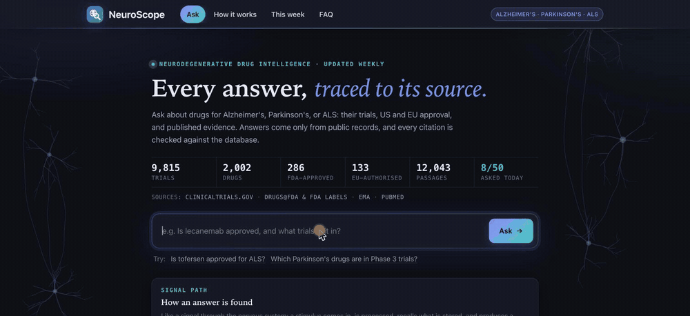

# NeuroScope

[](https://github.com/gosainansh8/neuroscope/actions/workflows/tests.yml)

Sourced drug-development intelligence for Alzheimer's disease, Parkinson's disease, and ALS. Ask about a drug or a pipeline, or have it write a report; every claim cites its record, and code checks each citation.



**Live demo: https://neuroscope-api-561220657386.us-central1.run.app** (50 new questions a day; repeats come from a cache)

## What it does

- **Combines six public sources:** ClinicalTrials.gov (9,815 trials), FDA approvals and labels, EU approvals from the EMA, PubMed (7,838 abstracts, searchable by meaning), company press releases and annual reports from SEC filings, and mechanisms of action from ChEMBL.
- **Identifies each drug under all its names:** codes, brands, and generic names (BIA 9-1067, Ongentys, opicapone) become one drug. Only exact or same-record matches merge names, never fuzzy ones, and every link records where it came from. A wrong merge is fixed by correcting the alias and re-linking.
- **Never infers approval:** approval comes only from FDA and EMA records, never from trial phase. A drug counts as approved for a disease only when its label or indication text says so, and answers quote that text.
- **Compares the three diseases:** the most common mechanisms, clinical endpoints (ADAS-Cog, MDS-UPDRS, ALSFRS-R), and biomarkers (amyloid PET, alpha-synuclein, NfL), with counts and example records.
- **Spots discontinued programs:** a drug's program in a disease is active, discontinued, dormant, or completed, judged from its trials, with the sponsor's stated reason. The weekly news flags a stop that left a drug with no active trial.
- **Answers or writes reports with checked citations:** a Gemini agent can only call nine read-only lookups. Every trial, FDA, EMA, SEC, and PubMed ID it writes must come from a lookup made for that answer, or it is flagged. Report mode writes a sectioned briefing (status, development, evidence, landscape, gaps) under the same check.
- **Maps the three pipelines:** the Atlas tab pins each disease to the brain region it strikes (hippocampus, substantia nigra, motor cortex and spinal cord) and opens its pipeline at a glance, with the companies filing about it and their latest SEC press release.
- **Stays current:** a weekly job on Google Cloud refreshes every source and records new trials and changes in status, phase, and completion date.

## How it works

```
ClinicalTrials.gov ─┐                          ┌─ find_drug, get_trials, get_program_status ─┐
FDA + EMA ──────────┤   Postgres + pgvector    ├─ get_fda_status, get_ema_status             │
PubMed ─────────────┼─► drugs, aliases, ───────┼─ search_literature, search_disclosures      ├─► Gemini ─► answer or report ─► citation check
SEC EDGAR ──────────┤   trials, approvals,     ├─ compare_diseases, list_pipeline            │
ChEMBL ─────────────┘   passages + embeddings  └─────────────────────────────────────────────┘
```

Each trial is tagged with every disease whose registry search returned it, provided its own text names that disease. That second condition drops studies the registry returns through synonyms, such as cancer trials matched by "PD" (as in PD-1). Company filings come from a reviewed list of listed companies with programs in these diseases, and are kept only where they name a tracked drug.

## Results

Scored by code (no model judges) on questions whose answers come from the database. The case file is `evals/cases.json` and full reports are in `evals/results/`:

53 cases cover US and EU approval, drugs approved only for other uses, trials, literature, the pipeline, Parkinson's, ALS, and questions the data cannot answer.

| Run (2026-11-12, `gemini-3.8-flash`) | Passed | Invented citations |
|---|---|---|
| Full run | 45 of 53 | 0 |
| The 8 failures, re-run after fixes | 8 of 8 | 0 |

Of the 8 failures, 3 were correct answers that didn't open with a clear "yes" or "no", 2 hit the lookup limit, 2 were Vertex AI timeouts, and 1 case was out of date. Fixes: yes/no questions now start with "Yes" or "No", and an agent that runs out of lookups answers from what it already has.

## Run it locally

Requires Python 3.11+ and Docker.

```bash
docker compose up -d                                  # Postgres 16 + pgvector
python3.11 -m venv .venv && source .venv/bin/activate
pip install -e ".[dev,api,vertex]"
cp .env.example .env && set -a && source .env && set +a
python -m neuroscope.db init
REQUIRE_DB_TESTS=1 pytest                             # 276 tests, no network needed

python -m neuroscope.ingest --disease alzheimers      # also: parkinsons, als
python -m neuroscope.fda load && python -m neuroscope.fda labels && python -m neuroscope.ema load
python -m neuroscope.pubmed load --disease alzheimers --min-trials 2 --per-drug 40
python -m neuroscope.sec load                         # needs SEC_USER_AGENT in .env
python -m neuroscope.outcomes classify && python -m neuroscope.mechanisms load
python -m neuroscope.embed run                        # needs a Google Cloud project (see docs)
uvicorn neuroscope.api:app --port 8080                # web page at http://localhost:8080
```

**Why it is built this way:** [`docs/DESIGN.md`](docs/DESIGN.md), a one-page write-up of the design decisions with an architecture diagram.

Deployment to Cloud Run and Cloud SQL is covered in [`deploy/README.md`](deploy/README.md). The merge rules, review history, per-source details, and known limitations are in [`docs/DETAILS.md`](docs/DETAILS.md).

## Stack

Python, Postgres with pgvector, Gemini and text embeddings on Vertex AI, FastAPI, Cloud Run, Cloud SQL, Cloud Scheduler, and GitHub Actions. The web page is a single self-contained HTML file.
