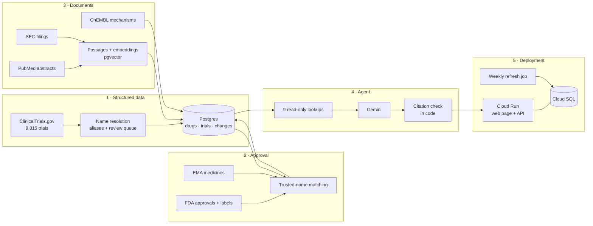

# NeuroScope: design decisions

NeuroScope answers questions about Alzheimer's, Parkinson's, and ALS drugs from public records, and every claim must point at the record it came from. Most design choices follow from one rule: **a wrong link is worse than a missing one**. A missing link shows up as a gap someone can fill. A wrong link quietly turns into a confident, cited, wrong answer.

## Architecture: five milestones

## 1. Aliases, not trial links, are the source of truth

A drug appears under many names: BIA 9-1067, Ongentys, and opicapone are one drug. Every trial intervention keeps the names exactly as the sponsor registered them, and its link to a drug is *computed* from those names and the alias table. To fix a wrong merge, you correct the alias and recompute every link (`curate reresolve`). No trial or original name is edited or deleted, and every correction is logged.

**Why:** linking was going to be wrong sometimes, so being wrong had to be cheap to undo. When the Parkinson's data loaded, pardoprunox (a separate dopamine agonist) had been attached to levodopa, and Apokyn (apomorphine injection) to a different apomorphine product. Each fix was one line in a reviewed CSV, and re-resolving corrected every affected trial at once. That scenario is a test (`test_wrong_merge_is_reversible`).

## 2. Unreviewed names don't link other trials

Names are learned automatically from each registry record: a code in parentheses, an "other name" field. A name learned from trial A links trial A only. If trial B matches it, B waits in a review queue until a person confirms the name.

**Why:** in a 1,500-record live sample, the earlier rule (learned names match everywhere) linked FDG-PET scans to insulin, a tracer code to the wrong tracer, and an arm labelled "Treatment A" to atabecestat. Sponsors put procedures, comparators, and arm labels in name fields, and one bad record could spread to every later trial. The cost is a review queue. Six reviewed files (237 decisions, each with a reason) took the Parkinson's and ALS load from 159 open conflicts to 0, and from 303 waiting interventions to 10.

## 3. Approval never comes from trials

Approval status comes only from regulator records: Drugs@FDA and FDA labels for the US, the EMA's medicines list for the EU. Trial phase and status are never used, and "approved" means approved for *some* use. A drug counts as approved for a disease only when the label or indication text says so, and answers quote that text.

**Why:** the obvious shortcuts are wrong. Masitinib finished Phase 3 trials and was refused by the EMA five times. Semaglutide is FDA-approved, for diabetes, not Alzheimer's. Donepezil has no EMA record because it was approved country by country, so the agent says "no centrally authorised EU medicine", never "not available in Europe". Each of these is an evaluation question.

## 4. The model never sees the database, and code checks its citations

The agent can only call read-only lookups that return records with their identifiers and caveats. After it answers, code compares every trial, FDA, EMA, SEC, and PubMed ID it wrote against what the lookups returned. Anything it made up is flagged.

**Why:** instructions alone don't stop a model from citing a plausible ID it never saw. A check in code does. In the latest 66-question evaluation (scored by code, no model judges) the single agent cited an identifier no lookup returned once, an FDA application number from the model's memory; the check flagged it, and the agent now gets one repair turn whenever that happens. The agent team, whose critic re-checks every sentence, had none. The check proves a cited record is real, not that it supports the sentence, so the page shows every source as a link.

## 5. Smaller choices with the same reasoning

- **Registry synonyms are filtered.** "Parkinson Disease" also returned 251 cancer trials through "PD" (as in PD-1). A trial counts toward a disease only if its own text names it.
- **Stricter matching for company filings.** Only drugs with a Phase 2+ program or an approval, never a generic substance, so "same" does not match the supplement "SAM-e".
- **Program status is labelled as a registry reading.** "Discontinued" means the latest trial stopped and none is active, which is not the same as a company announcing it.

## 6. A second mode: an ADK agent team

The same nine lookups and citation check also run behind an agent team built with Google's Agent Development Kit. A coordinator, which cannot query the database, asks three specialists (regulatory, clinical, evidence), each an ADK agent limited to its own lookups and called as a tool, then drafts an answer. A critic receives the draft and the raw records from every lookup, and removes or corrects any claim those records do not support. The code checks then run exactly as for the single agent.

**Why it is a switch, not the default:** on 66 questions both versions passed 63, but the team made 7.6 model calls per answer to the single agent's 3.4, so it was 2.3 times slower and 2.2 times the cost. What the extra calls bought was the one thing a sourced-answers tool cannot get wrong: the team had no invented citation, while the single agent once cited an FDA application number from the model's memory. That finding led to a fix in the single agent too (one repair turn naming any unchecked identifier), so the default got the benefit without the cost.

**What made the team fast enough to use:** ADK model calls got the same stall hedging as the single agent (a duplicate request after 8 seconds of silence), the specialists and critic got smaller thinking budgets than the coordinator, and a run that hits a dropped connection starts again. Together these took a typical team answer from about 70 to about 30 seconds.

